# Generative Fill for PhotoCraft

A small always-on-top bar that adds AI tools to [PhotoCraft](https://github.com/storytold/photocraft),
running entirely on your own computer through [ComfyUI](https://github.com/comfyanonymous/ComfyUI) and
FLUX.2 [klein]:

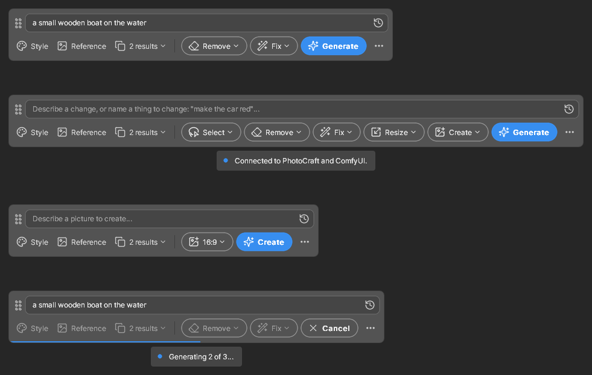

- **Generate** fills a selected area, like Photoshop's Generative Fill / Generative Expand. Enlarge the canvas
  (say 1080×1350 → 1080×1920), select the empty part, click Generate. The result arrives as a **new masked
  layer**; your original layers are never changed. You get several versions to choose from.
- **Expand** makes the canvas bigger (16:9, 4:5, 1:1… or a margin all round) and fills the new edges to
  match, like Photoshop's Generative Expand.
- **Presets** (like Photoshop's Neural Filters): Harmonize, Colorize, Restore old photo, Sky replacement,
  Remove reflections (windows, glasses), Background blur, Relight, and portrait tweaks, one click each.
- **More like this** (Generate Similar): new versions close to a result you almost like.
- **Remove** takes away whatever is in the selection and fills in the background behind it.
- **Select ▾** (with SAM 3) finds things by name: type "dog" or "boat" and it selects them, or pick Sky or
  People. It can also **remove the background** around what you typed (a layer mask, nothing deleted), and select
  the **foreground** or **background** by distance, with nothing typed.
- **Fix ▾** holds the one-click fixes: **Remove** what you typed, all people or all cars in one go; **Faces**;
  **Depth**; **Enhance**; and the **presets** (sky, relight, portrait, reflections, colorize, restore…).
- **Fix faces** (Fix ▾ › Faces) finds every face and restores it up close, sharper but the same person.
  **Replace face** gives one face the face of the person in another photo, keeping the expression and pose.
- **Reference picture**: give Generate a second image to take an object or a style from.
- **Edit** (Generate with nothing selected) changes the whole image as you describe it: "make it night",
  "change the jacket to red", "turn it into a watercolour". Everything you don't mention stays the same.
  **Edit by naming:** when the prompt names a thing ("make the car red", "change the door to blue", "give the
  woman a hat"), SAM 3 finds it, selects it in PhotoCraft and only that is redrawn. "The car" is the main one,
  "the cars" all of them. If it isn't found, the whole image is edited. A style left on is not used for these.
- **Create ▾** makes a new picture from just the prompt (text to image, 1:1, 4:5, 16:9…) and opens it as a new
  document. With no document open, the bar offers only this: pick the shape, type, click **Create**.
- **Sketch to image** (Create ▾ › From my sketch): draw roughly on a new empty layer (a few coloured shapes and
  lines are enough), keep that layer active, type what it is ("a potted olive tree"), and choose it. The area
  around your strokes is redrawn as the real thing, with your sketch's shape, place and colours and the photo's
  light. The result is a new layer above the sketch layer, which is left as it was. Your LoRAs are not used
  for sketches (with one on, an outline sketch tends to be erased instead of drawn). Make 2 to 4 results to pick from.
- **Photoshoot** (Create ▾ › Photoshoot) turns one photo of a product or a person into a whole shoot: 8 shots on
  the same set, in the same light, from different angles and poses, opened as layers in a new document.
  **Reshoot** redoes any one shot.
- **Enhance** (in Fix ▾) gives back the same picture at the same size, crisper and better lit, like a
  professional camera shot, as a layer you can fade or mask.
- **Upscale** (Resize ▾, 2× or 4×) redraws the whole image larger with new detail and opens it as a new document.
- **Styles** (the **Style** button; it shows the look while one is on, with ✕ to turn it off): 85 looks in tabs (Photo, Portrait, Product, Art, Design, Eras) that stay on for Create
  and whole-image edits. With nothing typed, Generate turns a photo into that style. Add an angle from the **+ Angles** tab on top (the panel stays open and shows "Look: … + Angle: …"):
  low angle, bird's-eye, from behind, wide shot…
- **Results are kept**: close the choice window and reopen it later, even days later, from *Other results*.

Nothing is uploaded anywhere: the bar talks only to PhotoCraft and ComfyUI on your own machine. The one
exception is a small check at startup that asks GitHub for the latest version number (turn it off in Settings).

Works on **Windows** and **macOS** (Linux builds are provided too). This is an independent project, not made by
the PhotoCraft developers.

## See it in action

All examples below were made with this app's own Generate, Remove, Expand and presets (FLUX.2 [klein] 9B, 4 steps).
The dashed box is the selection. The starting pictures were
made with the same model, so no real photos are involved.

**Generative Fill**: select the water, type *a small red wooden rowing boat on the water*, click Generate.

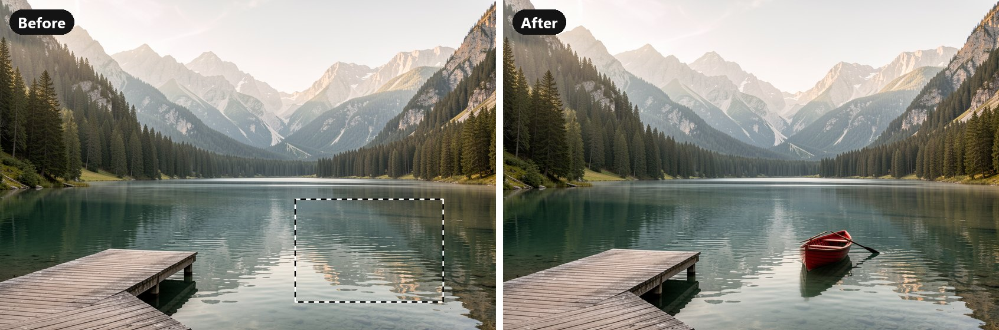

**Remove**: select the cone, type *traffic cone*, click Remove.

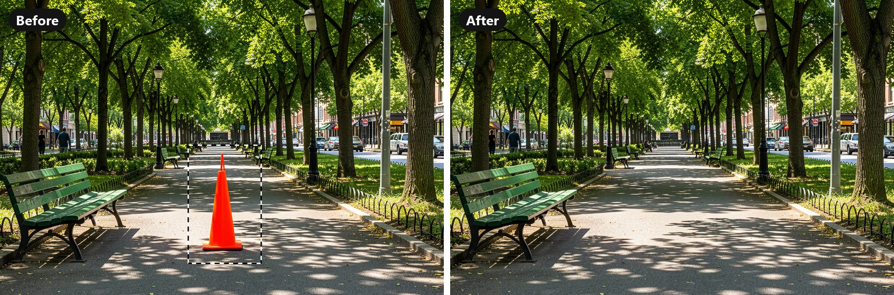

**Expand**: nothing selected, Resize ▾ › 16:9. A portrait photo becomes a wide one.

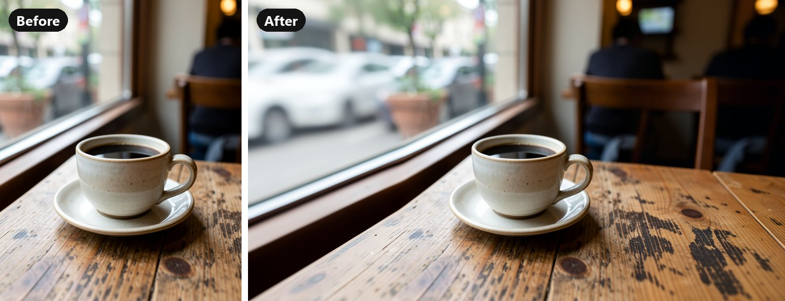

**Presets**: nothing selected, *Colorize black & white*, then *Sky: golden sunset*.

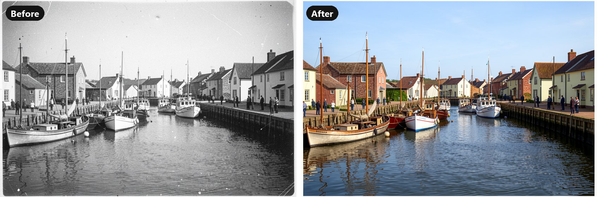

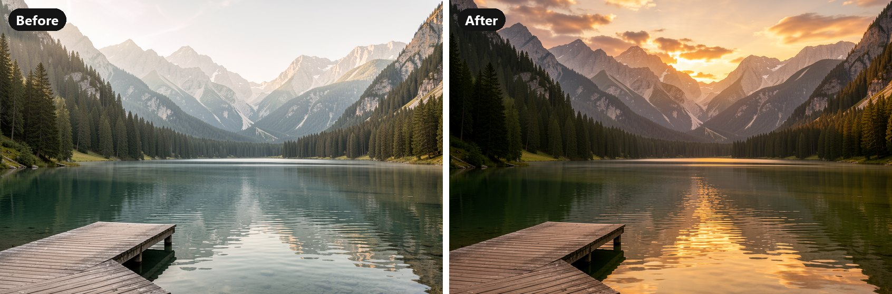

**Select ▾**: type *sky* (left) or *boat* (right) and pick it under Select. The tint shows what got selected.

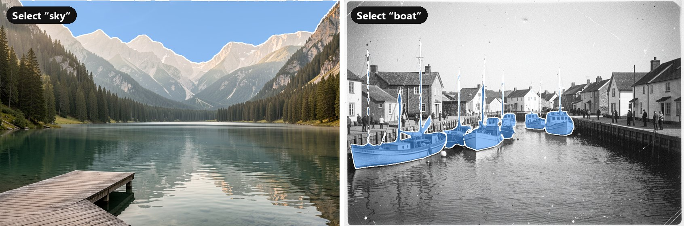

**Remove background**: type *coffee cup*, Select ▾ › Remove background, keep “coffee cup”.

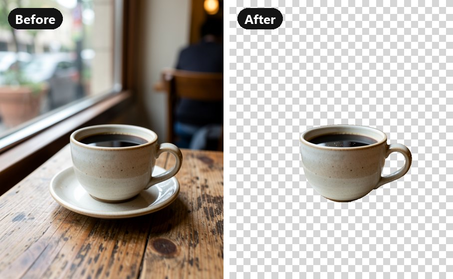

**Create ▾**: type *a red lighthouse on a rocky coast at dusk, waves, film photo*, Create ▾ › 3:2. Two of the
results to choose from; the one you pick opens as a new document.

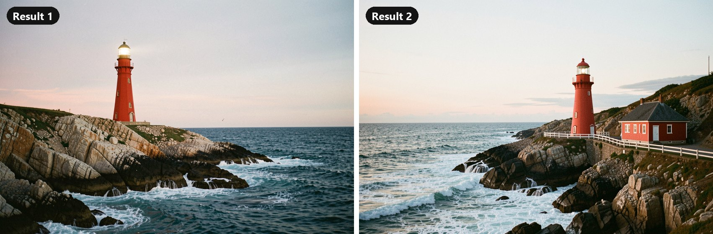

**Styles**: nothing selected, nothing typed, pick a style and click Generate. The same photo as Anime,
Watercolour and 1970s.

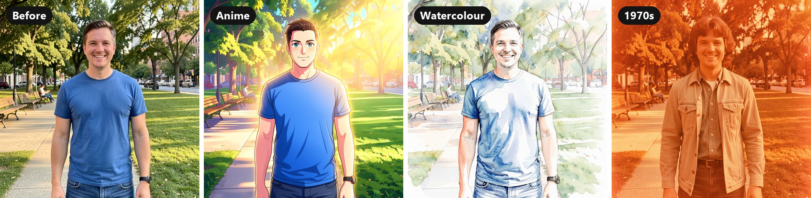

**Portrait** styles turn a phone selfie into a studio portrait, keeping the same face.

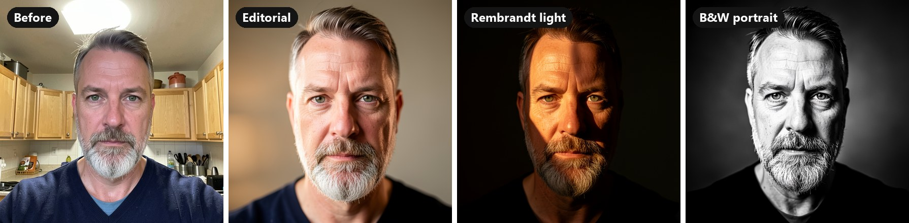

**Product** styles give a quick phone photo of something you sell a studio set, or a model holding it. The
product and its label stay the same.

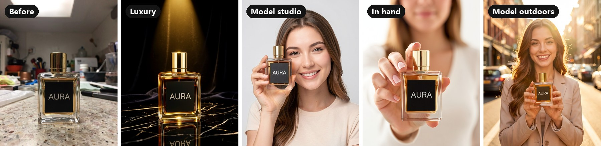

**Angles** add to the style (or work on their own): the same man and park from a new camera position.

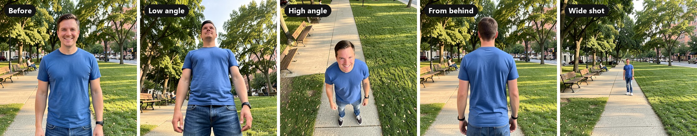

The Style panel: click a thumbnail to turn it on, click it again to turn it off.

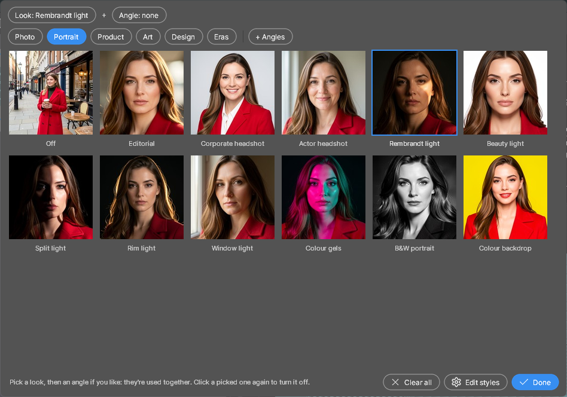

Not every try is a hit: that's why Generate makes several versions (3 by default) to pick from.

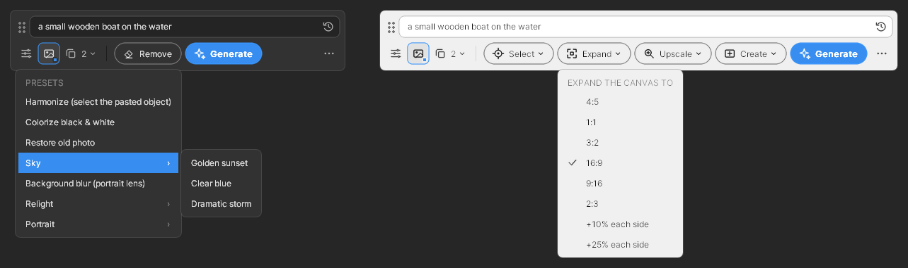

## What you need

| | |
|---|---|
| PhotoCraft | 0.20 or newer (also when started from the ArtCraft Launcher) |
| ComfyUI | A recent version (with FLUX.2 support), running at `http://127.0.0.1:8188` |
| GPU | An NVIDIA card with about 10 GB of memory is comfortable; Apple Silicon Macs work with ComfyUI's Mac setup |

### Model files (download once into ComfyUI)

| File | Put it in `ComfyUI/models/…` | Download |
|---|---|---|
| `flux-2-klein-9b-fp8.safetensors` | `diffusion_models/` | [black-forest-labs/FLUX.2-klein-9b-fp8](https://huggingface.co/black-forest-labs/FLUX.2-klein-9b-fp8) (log in and accept the licence first) |
| `qwen_3_8b_fp8mixed.safetensors` | `text_encoders/` | [Comfy-Org/flux2-klein-9B](https://huggingface.co/Comfy-Org/flux2-klein-9B/blob/main/split_files/text_encoders/qwen_3_8b_fp8mixed.safetensors) |
| `flux2-vae.safetensors` | `vae/` | [Comfy-Org/flux2-dev](https://huggingface.co/Comfy-Org/flux2-dev/blob/main/split_files/vae/flux2-vae.safetensors) |

**Or FLUX 3 Klein**, the newer and smaller model: pick it under **⋯ › Settings… › Image model**. It uses the same
VAE, plus:

| File | Put it in `ComfyUI/models/…` | Download |
|---|---|---|
| `flux3-image-klein-int8-convrot.safetensors` | `diffusion_models/` | [black-forest-labs/flux-3-image-klein-comfy](https://huggingface.co/black-forest-labs/flux-3-image-klein-comfy/blob/main/diffusion_models/flux3-image-klein-int8-convrot.safetensors) (5.8 GB) |
| `qwen3vl_4b_int8_convrot.safetensors` | `text_encoders/` | [black-forest-labs/flux-3-image-klein-comfy](https://huggingface.co/black-forest-labs/flux-3-image-klein-comfy/blob/main/text_encoders/qwen3vl_4b_int8_convrot.safetensors) (4.9 GB) |

**Or Qwen Image 2.1 Turbo** (8 steps on its own schedule):

| File | Put it in `ComfyUI/models/…` | Download |
|---|---|---|
| `qwen_image_2.1_turbo_int8_convrot.safetensors` | `diffusion_models/` | [Comfy-Org/Qwen-Image-2.1](https://huggingface.co/Comfy-Org/Qwen-Image-2.1/tree/main/diffusion_models) (6.8 GB) |
| `qwen3vl_8b_int8_convrot.safetensors` | `text_encoders/` | [Comfy-Org/Qwen-Image-2.1](https://huggingface.co/Comfy-Org/Qwen-Image-2.1/tree/main/text_encoders) (8.7 GB) |
| `qwen_image_2.1_vae_bf16.safetensors` | `vae/` | [Comfy-Org/Qwen-Image-2.1](https://huggingface.co/Comfy-Org/Qwen-Image-2.1/tree/main/vae) |

**Or Krea 2 Turbo**, for new pictures only: it can't be shown a picture, so a whole-picture edit
("make it night") is refused, and fills are rougher than with the others.

| File | Put it in `ComfyUI/models/…` | Download |
|---|---|---|
| `krea2_turbo_fp8_scaled.safetensors` | `diffusion_models/` | [Comfy-Org/Krea-2](https://huggingface.co/Comfy-Org/Krea-2/tree/main/diffusion_models) |
| `qwen3vl_4b_fp8_scaled.safetensors` | `text_encoders/` | [Comfy-Org/Krea-2](https://huggingface.co/Comfy-Org/Krea-2/tree/main/text_encoders) |
| `qwen_image_vae.safetensors` | `vae/` | [Comfy-Org/Krea-2](https://huggingface.co/Comfy-Org/Krea-2/tree/main/vae) |

Replace face's head-swap LoRA (below) is made for FLUX.2 Klein, so with the other models it borrows only the face.
Your own LoRAs are kept per model: switching models switches them too.

For **Select ▾** (optional; everything else works without it):

| File | Put it in `ComfyUI/models/…` | Download |
|---|---|---|
| `sam3.1_multiplex_fp16.safetensors` | `checkpoints/` | [Comfy-Org/sam3.1](https://huggingface.co/Comfy-Org/sam3.1/blob/main/checkpoints/sam3.1_multiplex_fp16.safetensors) (about 1.7 GB; needs a ComfyUI recent enough to have the *SAM3 Detect* node) |

For a **sharp Upscale** (recommended). Best is SeedVR2, a model made for restoring and enlarging photos; it
needs a ComfyUI recent enough to have the *SeedVR2* nodes:

| File | Put it in `ComfyUI/models/…` | Download |
|---|---|---|
| `seedvr2_7b_int8_convrot.safetensors` | `diffusion_models/` | [Comfy-Org/SeedVR2](https://huggingface.co/Comfy-Org/SeedVR2/blob/main/diffusion_models/seedvr2_7b_int8_convrot.safetensors) (8.3 GB) |
| `seedvr2_ema_vae_fp16.safetensors` | `vae/` | [Comfy-Org/SeedVR2](https://huggingface.co/Comfy-Org/SeedVR2/blob/main/vae/seedvr2_ema_vae_fp16.safetensors) (0.5 GB) |

Without SeedVR2, Upscale uses this smaller model with FLUX (good, a little less natural); with neither, it is
barely sharper than a plain resize:

| File | Put it in `ComfyUI/models/…` | Download |
|---|---|---|
| `4x-UltraSharp.pth` | `upscale_models/` | [Kim2091/UltraSharp](https://huggingface.co/Kim2091/UltraSharp/blob/main/4x-UltraSharp.pth) (67 MB) |

For a convincing **Replace face** (recommended), the BFS head-swap LoRA. Without it, Replace face only borrows
the other person's features and often still looks like the old face:

| File | Put it in `ComfyUI/models/…` | Download |
|---|---|---|
| `bfs_head_v1_flux-klein_9b_step3750_rank64.safetensors` | `loras/` | [Alissonerdx/BFS-Best-Face-Swap](https://huggingface.co/Alissonerdx/BFS-Best-Face-Swap/blob/main/bfs_head_v1_flux-klein_9b_step3750_rank64.safetensors) (0.3 GB) |

Restart ComfyUI after adding them. If your files have other names (for example a bf16 version), pick them in
**⋯ › Settings…**; the bar tells you at startup if a file is missing and where it goes.

**Mac note:** fp8 files may not run on Apple Silicon. If ComfyUI reports an fp8 error, use the bf16 versions
of the model and text encoder from the same Hugging Face pages and select them in Settings.

**Licence note:** this app is MIT-licensed, but the FLUX.2 [klein] 9B weights come with Black Forest Labs'
own licence, which is **non-commercial**. Read it on the model page before using results commercially.

## Install

Download the file for your computer from the **Releases** page of this repository:

- **Windows:** `GenFill-for-PhotoCraft-Windows.zip` → unzip → double-click `GenFill-for-PhotoCraft.exe`.
  Windows may show "Windows protected your PC" because the app isn't signed: click **More info › Run anyway**.
- **Mac (M1 and newer):** `GenFill-for-PhotoCraft-macOS-AppleSilicon.zip`;
  **Intel Mac:** `GenFill-for-PhotoCraft-macOS-Intel.zip`. Unzip and drag the app to Applications. The first
  time, **right-click the app › Open › Open** (it isn't signed by Apple). If macOS says it is damaged, run
  `xattr -cr "/Applications/GenFill for PhotoCraft.app"` in Terminal once.
- **Linux:** `GenFill-for-PhotoCraft-Linux.tar.gz` → extract → run `genfill-for-photocraft`.

## First time

1. Open the app, click **⋯** at the right end of the bar, then **PhotoCraft connection…**. This lets PhotoCraft
   accept commands from the bar (it sets a few per-user settings; nothing is installed into PhotoCraft).
2. Save your work, then quit PhotoCraft completely and start it again:
   - Windows: also quit the ArtCraft Launcher, including its tray icon.
   - Mac: PhotoCraft › Quit (Cmd+Q).
   - Linux: log out and back in.
3. Start ComfyUI. A message under the bar should say **Connected to PhotoCraft and ComfyUI**; the **⋯** menu
   shows both connections at any time.

## Use

The app is a small floating bar, like Photoshop's contextual task bar. It follows what you do in PhotoCraft:

- **Something selected:** prompt, **Remove**, **Fix ▾** and **Generate** (fills the selection).
- **Nothing selected:** prompt, **Select ▾**, **Fix ▾**, **Resize ▾**, **Create ▾** and **Generate** (changes the whole
  image, or only the thing the prompt names).
- **No document open:** prompt, the shape of the new picture (for example **1:1 ▾**) and **Create** (or press
  Enter).

The prompt is on top, the buttons under it. At the left of the buttons is what Generate will use: **Style** (shows the
look while one is on), **Reference** (a dot means a picture is set) and the **results count** (how many versions to
choose from). At the right are the menus, by what you want to do: **Select** (find things), **Fix** (remove, faces,
enhance, presets), **Resize** (expand, upscale) and **Create** (new picture, from a sketch, photoshoot). Drag the dots left of the prompt to move the bar; it
remembers where you put it. Messages appear in a small pill under the bar (click it to hide it). While it works,
a thin line along the bottom shows progress and **Generate** turns into **Cancel** (or press Esc). The **⋯** menu
has Settings, the PhotoCraft connection, the version and Quit.

**Generate (fill a selection)**
1. In PhotoCraft: select what to fill: the empty area after Image › Canvas Size, or something to replace or
   remove (hold Shift to add more areas).
2. In the bar: optionally type what should appear ("remove it" works for taking things away), choose how many
   results you want (1–4, the stacked-squares button), then click **Generate** (about 20–40 seconds per result on a 10 GB card).
3. With more than one result, a **Choose a result** window shows them side by side: click the one you like (or
   press 1–4). **Discard all** adds nothing. With 1 result it goes straight in.
4. A new layer "Generative Fill" appears with a soft mask. Paint on the mask to adjust, or Undo to remove it.

The prompt box remembers your last 15 prompts: click the clock icon inside it to pick one again.

**Remove**: select the object (generously, including its shadow), optionally type what it is ("basket",
"the person on the left"), and click **Remove**. Naming it helps when the selection holds more than one thing.

**Reference picture**: click **Reference** and pick an image file, then mention it as
"image 2" in the prompt: "the logo from image 2 as a poster on the wall", "a chair like the one in image 2",
"in the style of image 2" (with nothing selected, that restyles the whole picture). Click it again to choose another or stop using it. Remove
ignores the reference. Like any fill, not every try picks it up, so ask for 3 results.

**Changed your mind?** The *Choose a result* window stays open after you pick one, like Photoshop's variations:
the one in PhotoCraft is marked *In PhotoCraft*, and clicking another one swaps it in. The same layer is replaced, in
the same place, and a fill keeps exactly the same mask. *Done* keeps the one in PhotoCraft. If you closed the
window too soon, **Other results** on the bar brings it back until you start something new. It won't swap if
you deleted the layer or switched to another document, and it says so. A created picture opens the other
result as another new document.

**Even days later.** GenFill keeps every set of results you placed one from (the last 50 sets, in the `results`
folder of GenFill's data folder, `%LOCALAPPDATA%\PhotoCraftGenFill` on Windows), and marks the layer it added (in the layer's metadata, which is saved with the
document as PSD). Select that layer in PhotoCraft's Layers panel any time, even after restarting
everything, and **Other results** appears on the bar: it opens that set again so you can swap. Reopened sets
can't make *More like this*. Change how many sets are kept with `keep_results` in the settings file.

**More like this**: in the *Choose a result* window, click *More like this* under a result. You get new
versions that keep its layout and vary the details; the one you picked stays as choice 1.

**Style**: the **Style** button under the prompt opens thumbnails of each look, in tabs:

- **Photo**: Professional photo, Film photo, Cinematic, Movie poster, Golden hour, Low-key, Black & white
  film, Film noir, Instant photo, 2000s digital, Fashion editorial, Interior bright (a real-estate look for room photos),
  Kodachrome, Classic Chrome, CineStill night, Bright & airy, Dark & moody, HDR, Long exposure, Tilt-shift, Infrared,
  Toy camera, Dreamy glow, Documentary.
- **Portrait**: close-up head-and-shoulders looks, each a classic lighting setup: Editorial, Corporate headshot,
  Actor headshot, Rembrandt light, Beauty light, Split light, Rim light, Window light, Colour gels, B&W portrait,
  Colour backdrop. Good for turning a phone selfie into a studio portrait.
- **Product**: Studio white, Hero shot, Flat lay, Lifestyle, Luxury, Podium, Splash, Nature, and for food, Food
  overhead and Food dark & moody. Each brings its own angle and set, from an online-shop white background to a
  low-angle hero shot or a top-down flat lay.
  With a model: Model studio, Model close-up, In hand, Model lifestyle, Model outdoors put a woman holding
  your product in different poses, from beside her face in the studio to a sunny street.
- **Art**: Anime, Japanese ink, Watercolour, Oil painting, Pencil sketch, Comic book, 3D animation, Fantasy art,
  Neon cyberpunk, Toy figure, Claymation, Pixel art, Stained glass, Retro 80s, Surreal, Gouache, Charcoal,
  Ink illustration, Impressionism, Manga, Chibi, Picture book, Gongbi, Low-poly.
- **Design**: Art Deco, Art Nouveau, Bauhaus, Minimalist, Vintage poster: graphic looks from design movements.
- **Eras**: Victorian, 1920s, 1950s, 1970s, Retro-futurism, Future: the clothes, the setting and the photography of the time.

- **Angles** (20): Low angle, High angle, Bird's-eye, Worm's-eye, Dutch tilt, Close-up, Side profile, From behind,
  Wide shot, Fisheye, Drone aerial, Eye level, Three-quarter, Over the shoulder, Point of view, Medium shot, Full body,
  Extreme close-up, Telephoto, Through the frame. An angle is chosen on its own and **adds to the style**: the bar shows both,
  for example *Cinematic · Low angle*. On a photo with nothing typed it shows the same people and place from the
  new angle (with Studio white the bottle turns, it doesn't become a straight top-down shot).

Click one and it stays on, with its name on the bar, until you click it again or pick *Off*; *Clear all* at the
bottom of the panel turns off the style and the angle together. A style describes the look in words and
is put before your prompt, for **Create** and **whole-image edits**. With a style on, click **Generate** on a photo
with nothing typed and it just turns the photo into that style: Photo and Art styles keep the people and the
framing; Portrait styles keep the same face, eye colour, skin tone and expression and change the light and backdrop (Corporate headshot also puts on smart clothes); Product styles keep the product itself (shape, colours, label) and give it a new set, angle and light, so a
quick phone photo of something you sell becomes a studio shot; the model styles keep the product the same and add a woman holding it; the food styles keep the dish, Interior bright keeps
the room and its furniture, and the Eras keep the people's faces and poses while their clothes change. Small text on labels sometimes comes out garbled:
make a few results and pick a clean one. Fills, presets, Remove and the face tools don't use styles, because they
have to match the photo.

*Edit styles…* opens `styles.json` (next to the settings file) for your own styles: add one with a name and a
sentence or two describing the look, use a built-in style's name to change its words, or list names under
`hidden` to leave them out. The built-in styles themselves come with the app, so updates can improve them. A
new or changed style gets its thumbnail made the next time the panel opens (ComfyUI must be running).

**Presets**: under **Fix ▾ › Presets** are ready-made edits; clicking one runs it straight away
(what's typed in the prompt box is left alone). With nothing selected they work on the whole image; with a selection,
only there.

| Preset | Use it for |
|---|---|
| Harmonize | Select an object you pasted in: its light, colour and shadows are matched to the photo |
| Colorize black & white, Restore old photo | Old family photos |
| Sky: golden sunset / clear blue / dramatic storm | Replaces the sky and adjusts the light to match |
| Remove reflections: windows / glasses | Shop windows, glass doors, display cases; eyes hidden behind shiny lenses. The colours stay the original's, and your LoRAs are not used for these. Busy reflections (people, shop fronts) may only fade: select just the glass so nothing else changes, and make a few results to pick from |
| Background blur | A portrait-lens look; the subject stays sharp |
| Relight: golden hour / soft studio / night | Changes the lighting of the whole scene |
| Portrait: smile, look at the camera, retouch skin, younger, older | One person in the photo; select the face for the most control |

Keep the selection as it is while choosing; if it changes, the window asks you to put it back or Generate again
so the result can't land in the wrong place.

**Edit (whole image)**: deselect everything (Select › Deselect), type the change ("make it night, moonlight",
"change the car to red"), click **Generate**. The edited image arrives as a new layer named "Edit" above your
original, so you can lower its opacity, mask parts of it, or delete it. Edits are made at about 2 megapixels and
scaled to your image's size, so on large photos they are softer than the original; use **Upscale** afterwards or
mask the edit to where it matters. To change just one part, select it and use Generate with a prompt instead.

**Expand**: with nothing selected, click **Resize ▾** and pick a shape (4:5, 1:1, 3:2, 16:9, 9:16, 2:3, or
+10% / +25% on each side); it starts right away. It only ever grows the canvas, centred, and fills the new area to match (using the results count
from Generate). Your document is enlarged only when you pick a result; the filled edges come in as a layer
"Generative Expand" above your picture. To expand in one direction only, use Image › Canvas Size yourself,
select the empty part and use Generate.

**Upscale**: with nothing selected, click **Resize ▾** and pick 2× or 4× larger. The bigger image opens as a new document; the original is
untouched. With SeedVR2 installed (see the model tables above) it restores real detail, fine lines and texture in
one step, a few seconds per piece; it follows the picture, not the prompt. Without it, 4x-UltraSharp enlarges the
picture and FLUX lightly redraws it; without either, the enlarging is a plain resize and the result stays soft.
**⋯** shows which one Upscale uses. In the settings file, `seedvr_model` ("" turns SeedVR2 off), `seedvr_tile`
(piece size, 2048; lower it if your GPU runs out of memory) and `upscale_model` change this.

**Create ▾**: type a description of the picture you want ("a red lighthouse on a rocky coast at dusk, film
photo"), click **Create ▾** and pick a shape (1:1, 4:5, 3:2, 16:9, 9:16, 2:3; the menu shows the size: at least Full
HD, so 16:9 is 1920×1080). You choose from the results as with Generate, *More like this* works too, and the one you pick opens
as a new document; your open pictures are not touched. Describe it like a photo caption: subject, place, light,
style ("film photo", "watercolour", "studio product shot"). With a **reference picture** set you can say
"the chair from image 2 in a sunny loft". For print sizes, use **Upscale** on the result.

**Photoshoot** (Create ▾ › Photoshoot): pick a shoot. **Product** has *Clean studio white*,
*Skincare morning light*, *Luxury dark*, *Kitchen / lifestyle table* and *Outdoor summer*. **People** has *Studio
headshots*, *Loft editorial* and *Street / city casual*. Then choose a photo of the product or the person (a phone
photo is fine). GenFill cuts the subject out of the photo, makes a hero shot on the shoot's set, and then makes the
other shots from that hero, so every shot shares the set, the light and the colour grade. The angle, framing and
pose change from shot to shot. The shots open as layers in a new document, named "Shot 1 – hero", "Shot 2 – …" and
so on. Hide layers to see the others, or export each one.

- **How many and what shape:** in the same menu, **Shots** is 4, 8 (the default) or 12, and **Shape** is the
  same shape setting as Create (square by default).
- **How long it takes:** 8 shots take about 6 to 9 minutes on a 10 GB card. Cancel keeps the shots already finished.
  If a shot fails, it is tried once more and then skipped; the message says which shots are missing.
- **Reshoot:** select one shot's layer and a **Reshoot** button appears on the bar. It makes new versions of just
  that shot, on the same set and with the same product or person, and you choose one as with Generate. The layer
  keeps its place and its name. Reshoot works as long as the shoot is among the last 50 you made and the document
  hasn't been resized.
- **Your own shoots:** **Edit shoots…** opens `shoots.json`. Add a shoot with a name, `"kind"` (`"product"` or
  `"people"`) and a `"set"`: a sentence or two about the place, the light and the colour grade. To change a
  built-in shoot, use its name. Put names in `"hidden"` to leave them out of the menu. You can also give a shoot
  its own `"shots"` list (the first one is the hero).

Tip: the product's label and the person's face are kept as closely as the model can, but small print on a label
can still come out wrong in a shot or two. Reshoot those shots a few times and pick the version that reads right.

**Enhance**: with nothing selected, **Fix ▾ › Enhance: crisper, better light**. It works in two passes:
first it finds better light and colour (only those are kept, so nothing in the picture changes), then it
redraws the detail lightly while following your picture closely, at full size on big photos. People, objects
and framing stay the same. It arrives as a layer "Enhance" above your picture: lower its opacity to taste.
Typing in the prompt steers the light ("golden hour light", "moody, low key"). You get up to two results to
choose from. How far the light and colour may change is `enhance_strength` in the settings file (0.35).

**Select ▾** (needs the SAM 3 model above): with nothing selected, type what you're after in the prompt box
("dog", "boat", "red car"), then open **Select ▾** or **Fix ▾**:

- **Select ▾ › “dog”** selects every dog it finds; **Sky** and **People** work without typing.
- **Fix ▾ › Remove › “dog”**, **People** or **Cars** finds them, selects them and fills them away like Remove (you choose
  from the results as usual). Only the found shapes are redrawn, not a box around them.
- **Select ▾ › Remove background, keep “dog”** puts a layer mask on the active layer that hides everything else. Nothing is
  deleted: paint on the mask to fix edges, or delete the mask to undo it. A Background layer becomes "Layer 0".

**Depth** (Depth Anything V2 in ComfyUI works out how far away each part of the picture is; the effects are
worked out from the picture's own pixels, so nothing is redrawn and faces, text and products stay exactly as they
are). Each arrives as a new layer:

- **Fix ▾ › Depth › Lens blur: subject sharp** blurs the rest more the further it is from the main subject, like a
  wide-open lens. Type a thing first ("the dog") for **Lens blur: “the dog” sharp** to choose what stays in focus.
- **Haze in the distance** and **Fog** fade the far parts into the air, thicker the further away.
- **Select ▾ › By distance › Foreground** or **Background** selects what's near or what's far, no words needed.

The first use loads the depth model (about a minute); after that it takes a few seconds.

- **Fix ▾ › Faces › Sharpen faces** finds every face and restores each one up close at high resolution: sharper eyes, lashes, skin
  and hair, and still the same person. With SeedVR2 installed (the Upscale model, see the model tables) it uses
  that, which keeps people most like themselves; otherwise FLUX partly redraws each face. They arrive as one
  layer holding just the faces with soft edges: lower its opacity or erase a face you'd rather keep. It ignores
  the prompt box. To change faces, type a wish ("smiling", "eyes open") and pick **Faces › As typed: “smiling”**
  instead: FLUX redraws the faces to match, so they change more.
- **Faces › Replace with a photo…** puts the person in that photo in place of one person in your picture. It
  changes the face inside your selection (draw a rough box around it), or the biggest face when nothing is
  selected. It asks for the photo every time, so a different person gets their own; to use the same photo
  again, pick **Replace with *name*.jpg**.
  - **With the BFS LoRA** (see the model tables; ⋯ shows whether Replace face has it),
    the whole head is swapped, hair included: the head angle, expression and light come from your picture, the
    face and hair from the photo. Only the photo's head is used, so its clothes and background never come
    along; the clothes, body and background around the head stay yours. Your own LoRAs are left out for this.
  - **Without it**, only the face changes and your picture's hair stays. It works best when the photo matches
    your picture (turned the same way, a similar expression); otherwise it mostly keeps the old face. With a
    photo of the same person it works as a restore: a blurry face comes back sharp and clearly them.

  Strong backlight is its weak spot: the new face can come out lit from the front. `face_swap_lora` in the
  settings file names the LoRA ("" uses the face-only way).

How strongly FLUX redraws faces for Fix faces is set in the settings file (`face_strength`, 0.5). Higher is
sharper but less like before.

Tips: short, plain nouns work best ("person", "car", "bench"). Name the whole thing: "coffee cup" keeps the
coffee, "cup" may leave a hole where it is. It finds every match; to get just one, add `:1` ("bench:1" picks the
clearest bench). Several things at once: separate them with commas ("dog, ball").

The bar follows PhotoCraft's theme automatically. It also follows PhotoCraft itself: when you close PhotoCraft the
bar hides, and it shows again when PhotoCraft opens (turn this off with **⋯ › Hide while PhotoCraft is closed**).
On Windows, **⋯ › Start with Windows** starts the bar hidden when you log in, so it appears by itself whenever you
open PhotoCraft. Starting the bar by hand always shows it.

## Settings

**⋯ › Settings…** has the ComfyUI address (with a Test button), the image model (FLUX.2 Klein 9B, FLUX 3 Klein,
Qwen Image 2.1 Turbo or Krea 2 Turbo) and its three files (dropdowns list what your ComfyUI has; each model remembers
its own), steps (FLUX.2: 4 = fast, 8 = finer; FLUX 3: 8 = fast, 16 = finer; Qwen and Krea: 8), upscale strength (0.2 subtle – 0.4 strong), PhotoCraft's control
port, and:

- **Check compatibility**: after a PhotoCraft update, runs every PhotoCraft step this window uses and shows
  OK/FAIL for each. It may open and close a test tab; your open documents are not touched. The window also checks
  at startup and refuses to run a step PhotoCraft no longer supports rather than do something unexpected.
- **Undo PhotoCraft setup**: removes the connection settings again.

The number of results per Generate is chosen on the bar and remembered.

**Updates**: at startup the bar asks GitHub whether a newer version exists; if so, a blue dot appears on
**⋯**, and the menu has a link to the download page. Turn this off under Settings › Updates. The **⋯** menu
shows the version you have.

## Troubleshooting

| Status says | Do this |
|---|---|
| PhotoCraft connection isn't set up | Click **⋯ › PhotoCraft connection…**, then restart PhotoCraft as above. |
| Can't reach PhotoCraft | PhotoCraft isn't running, wasn't fully restarted after Setup, or Preferences › Integrations › Allow Agent Control is off. |
| ComfyUI is not running | Start ComfyUI, or fix the address in Settings. |
| Model file missing | Download it into the folder shown, restart ComfyUI. |
| Couldn't find … in the picture | Use a simpler word ("person" instead of "the man in the hat"). |
| Select (SAM 3): model missing | Download the SAM 3 file into `ComfyUI/models/checkpoints/`, restart ComfyUI. If it says ComfyUI is too old, update ComfyUI. |
| Out of memory, or too slow | Lower *megapixels* in the settings file (default 2.0; 1.0 is about twice as fast but softer), close other GPU programs. Created pictures stay at least Full HD. |

Settings are stored in `%APPDATA%\PhotoCraftGenFill` (Windows), `~/Library/Application Support/PhotoCraftGenFill`
(Mac) or `~/.config/photocraft-genfill` (Linux).

## How it works

The window uses PhotoCraft's built-in local control channel. For Generate it exports a PNG copy of your image
(your document keeps its name), sends it to ComfyUI with a mask of the selected area, colour-matches the result to
the original so there is no visible seam (in a big photo it sends only the selection plus its surroundings,
enlarged, so the fill comes back as sharp as the photo), and brings it back as a new layer, pasted in place, with a layer mask from
your selection. It briefly uses the clipboard for that and waits if another program holds it. Upscale works in
overlapping tiles so large images fit in GPU memory: each piece is restored by SeedVR2 (or enlarged by the
upscale model and lightly redrawn by FLUX) inside ComfyUI, and the pieces are blended back together.

PhotoCraft's own *Filter › Plug-ins* can't host this: those plug-ins are sandboxed WebAssembly filters without
network access, prompts or new layers. That's why this is a separate window.

## Run from source / build

Python 3.12:

```bash
python -m venv .venv
.venv/bin/pip install -r requirements-dev.txt   # Windows: .venv\Scripts\pip
python -m pytest tests
python GenFill.pyw
python build.py        # standalone app in dist/
```

Pushing a tag like `v1.0.0` makes GitHub Actions build the Windows, Mac and Linux apps and attach them to a
release.
